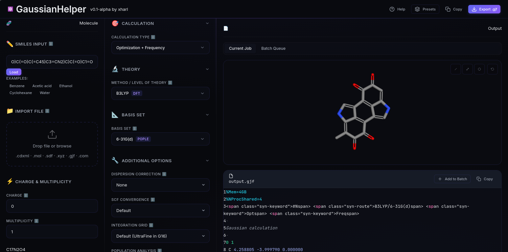

# GaussianHelper

**Current version: v0.3-alpha** · [Release notes](CHANGELOG.md) · [Architecture](docs/ARCHITECTURE.md) · [Validation model](docs/VALIDATION.md)

GaussianHelper is a client-side workbench for preparing Gaussian 16 input files (`.gjf`), generating batch and scheduler scripts, and checking the outputs that come back. It is built for computational chemists who would rather see the route section, the geometry, and the evidence behind a pass/fail verdict than trust a black box.

Everything runs locally in the browser. There is no backend, no telemetry, no upload, and no autosave: structures, projects, and logs stay on the machine that opened them. The app prepares and validates files; it does **not** run Gaussian.



---

## Quick start

**Portable bundle (no install).** Download `gaussian-helper-bundle-<commit>.zip` (Windows) or `.tar.gz` (Linux) from the [latest release](https://github.com/xharl/GaussianHelper/releases/latest), extract it, and run `run.bat` / `./run.sh`. The bundle is a static build served from a local Python/PowerShell HTTP server so the browser's module and CORS rules are satisfied. Release assets are named with the commit they were built from.

**From source.**

```bash
npm install
npm run dev      # Vite dev server
npm test         # Vitest suite
npm run build    # static build in dist/ + local dist.zip / dist.tar.gz
```

Node.js is the only prerequisite. The build outputs (`dist/`, `dist.zip`, `dist.tar.gz`) are gitignored; published bundles live on the Releases page.

---

## What it does

### Build the input

- **Structure input** — draw in the 2D editor, paste SMILES, or import `.xyz`, `.mol`/`.sdf`, and ChemDraw `.cdxml`. Coordinates are parsed strictly: truncated files, unknown elements, and non-finite coordinates are rejected instead of being repaired.
- **3D and conformers** — one 3D structure is generated immediately; the **Conformer Ensemble** panel can generate, minimise (MMFF94), RMSD-prune, and Boltzmann-rank up to 50 conformers. The chosen conformer is recorded in the task. See [Conformer ensembles](#conformer-ensembles).
- **Theory & parameters** — method, basis set (including the Karlsruhe `def2*` family and ECP-bearing sets), SCF, integration grid, dispersion, solvation, population analysis, Link 0 memory/processors/checkpoints, job type, and free-text route keywords. See [Heavy elements and GenECP](#heavy-elements-and-genecp).
- **Multi-fragment systems** — optional per-fragment charge/multiplicity specifications for complexes, counterpoise inputs, and fragment guesses. See [Multi-fragment inputs](#multi-fragment-inputs).
- **Continuations** — a task can be declared "continues from an earlier step"; the app sets `Geom=Checkpoint Guess=Read` (or `AllCheck`), requires a checkpoint binding, and can export a two-link `--Link1--` input. See [Workflow Workbench](#workflow-workbench).

### Check the theory before running

- **Pre-flight chemistry lint** — metadata-driven warnings for missing dispersion, hybrid functionals on minimal/double-zeta Pople bases, `Freq` without thermochemistry settings, `Opt=TS` without a Hessian, `TD` on a non-range-separated functional, transition metals with default SCF, heavy elements without an ECP, and basis sets on methods that do not take one.
- **Heuristic cost estimate** — an explicitly labelled order-of-magnitude core-hour range from atom count, method rung, basis size, job type, and core count. It is not a benchmark and says so.
- **Route keyword registry** — every method, basis, job-type, and option token written into the route is checked against a documented Gaussian 16 registry. Unknown tokens are warnings that quote the token; route-unsafe characters are hard errors. See [Route keyword validation](#route-keyword-validation).

### Inspect the output

The **Output Inspector** reads multiple `.log`/`.out` files locally and reports, with source line evidence:

- normal/error termination and explicit SCF convergence/failure text;
- the **reference** `SCF Done` energy and, separately, the **method** final energy for post-HF and composite jobs (`E(MP2)`, `CCSD(T)=`, `E(CBS-QB3)`, `G4(0 K)=`, `W1BD=`, …);
- optimisation and frequency records, including every negative mode and the smallest magnitude;
- **thermochemistry** for `Freq` jobs: zero-point correction, thermal corrections to E/H/G, the corresponding totals, and the temperature/pressure they were computed at;
- the **route echo** from the log and the `%Chk` / `%OldChk` filenames, so a stale checkpoint or a different functional is visible;
- warnings and errors with line references, plus a CSV export of the section-level report.

A pass in the inspector means "the text contains the required evidence", not "the chemistry is right". Missing or unrecognised markers are reported as `unknown` or `incomplete`, never as success.

### Chain jobs and validate each step

The **Workflow Workbench** turns calculation snapshots into a dependency DAG: one `.gjf` per task, topologically ordered, with explicit checkpoint bindings and explicit validation gates. A dependent task stays blocked until every prerequisite's imported output passes. See [Workflow Workbench](#workflow-workbench).

### Batch and bundle

- **Batch Generator** — queue configs and export a Windows `.bcf` batch control file or a Linux `.sh` runner. The shell runner classifies each job by Gaussian's termination markers (`Normal termination`, `Error termination`, neither) rather than the process exit code, because Gaussian exits `0` even on error termination. It is a termination check only, not the Workbench gate set.
- **Workflow bundle** — export every task's input, a data-only DAG manifest, per-task provenance sidecars, and SLURM/PBS/plain-bash templates in one `.zip`. The scripts are inert templates and do not validate results.

---

## Conformer ensembles

Generating one conformer and calling it "the structure" hides the largest error source in computed energetics. **Generate ensemble** does the more honest thing:

- generates up to the requested number of conformers with OpenChemLib's ETKDG-style generator (10 by default, hard cap 50, deterministic seed);
- minimises each with **MMFF94** and computes real force-field energies;
- prunes duplicate geometries by heavy-atom RMSD (0.5 Å);
- sorts the survivors by energy and reports each conformer's energy, relative energy, Boltzmann population at 298.15 K, and RMSD to the lowest conformer;
- warns when the retained spread exceeds **2 kcal/mol**, because the reported value then depends on the geometry chosen;
- records the chosen conformer, its energy/population, and the ensemble spread in the task configuration (provenance only — the generated `.gjf` is byte-identical with or without the metadata).

**Queue top-k conformers** creates sibling tasks, one per retained conformer, sharing the same dependencies.

Limitations, stated plainly:

- **Tautomers and protonation states are not enumerated.** OpenChemLib 9.22 has no tautomer generator (only canonicalisation flags). Charge and multiplicity define the species; enter the protomer you want. This is out of scope rather than approximated with guessed chemistry.
- MMFF94 energies are gas-phase force-field energies, not free energies. The population table ranks a finite stochastic search; it is not proof that the global minimum was found.
- If MMFF94 cannot type an atom (platinum, for example) or minimisation does not converge, the energy is reported as **unavailable** and populations are withheld. Nothing is estimated.
- The MMFF94 parameter tables add roughly 0.5 MB gzipped to the portable bundle. `vite.config.js` aliases `openchemlib/dist/resources.json` so the offline build does not fetch them at runtime.

---

## Heavy elements and GenECP

The basis list includes `LanL2DZ`, `LanL2MB`, `SDD`, `SDDAll`, `CEP-*`, and the `def2*` family. Two different mechanisms are involved, and the app keeps them distinct:

- **Self-contained ECP bases** — `SDD`, `LanL2DZ`, and the `CEP-*` keywords already include the matching effective core potential. `#P B3LYP/SDD` on Pd needs no `Pseudo=Read` and no appended ECP block. Adding one is wrong, so the app does not.
- **Mixed-basis / explicit ECP** — when different elements need different bases (say `6-31G(d)` on C/O and `LanL2DZ` on Pd), the generator supports an explicit **GenECP** mode: route `Method/GenECP`, per-element basis blocks, and an ECP block in Gaussian's documented *simplified ECP input format* (a block may reference an internally stored basis keyword instead of raw parameters). Raw ECP parameter tables are deliberately **not** shipped: inventing or transcribing them without an authoritative source is not acceptable, and the simplified format does not need them.

Basis entries carry documented element coverage and whether an ECP is included. The pre-flight lint warns when a selected basis does not cover an element in the molecule (for example `6-31G(d)` with Pd) and when a heavy element is present without an ECP. Where Gaussian's documentation does not state a range in a machine-readable form, coverage is `unknown`, never guessed.

---

## Multi-fragment inputs

Gaussian's fragment syntax is one charge/spin line carrying the total pair followed by one pair per fragment, with atom labels carrying `(Fragment=N)`:

```
0,1 0,1 0,1
 O(Fragment=1)      0.000000    0.000000    0.000000
 H(Fragment=1)      0.490000    0.760000   -0.290000
 O(Fragment=2)      0.000000    0.000000    2.980000
```

The generator accepts an optional `fragments` array (`{ charge, multiplicity, atomRange: [start, end] }`, inclusive and 0-based); the default single fragment reproduces existing output byte-for-byte. Validation checks that ranges tile the atom list exactly once, that each fragment's charge/multiplicity parity is consistent with its own atoms, and that fragment charges sum to the molecular charge — errors name the fragment index. Single-fragment inputs are unchanged.

**Current limitation:** there is no fragment editor in the UI yet. The config field, generator, validation, and project persistence are in place; a control that assigns atom ranges is a follow-up. Until then, fragments can be set through the workflow/project API, not through the form.

---

## Route keyword validation

`src/data/keywordRegistry.js` is a machine-readable registry of the Gaussian 16 keywords the app writes: methods and bases seeded from the curated lists in `src/data/methods.js` and `src/data/basisSets.js`, plus job types and option families (SCF, grid, dispersion, solvation, population, geometry, guess, Gen/GenECP, symmetry, and so on). A data test fails if a curated keyword is missing from the registry, duplicated, or disagrees with its metadata, so the two cannot drift apart.

`validateRouteTokens()` classifies problems by severity:

- **Unknown keyword → warning.** The message quotes the offending token (for example `"FOO-2X"`), because Gaussian may accept a functional, `IOp`, or keyword newer than this app's list. Warnings appear in the preview's pre-flight panel and never block generation.
- **Route-unsafe characters → error.** Whitespace, `/`, `=`, `#`, `%`, or a control character inside a single token cannot be emitted safely.

The free-text **Extra Keywords** field is pasted verbatim, so it is skipped by default. Two advanced switches exist in the preview, and the same fields can be set programmatically:

| Route field | Effect |
|---|---|
| `allowUnknownRouteTokens: true` | Suppresses unknown-keyword warnings. It does **not** suppress route-unsafe-character errors. |
| `strictRouteTokens: true` | Also validates the free-text Extra Keywords field against the registry. |

Only the keyword that owns a parenthesised list is token-checked: `SCF=(Tight,MaxCycle=200)` validates `SCF`. Documented sub-options are recorded in the registry but are not individually rejected, because Gaussian has many legitimate sub-options beyond this app's list.

---

## Workflow Workbench

A project is a DAG of immutable calculation snapshots. Each task carries its config, input/output/checkpoint filenames, dependencies, an optional checkpoint source, explicit gates, attempt history, and a bounded provenance record. The list is topologically ordered and rejects cycles; a dependent task stays blocked until every prerequisite output passes.

**Node view.** The **Graph** toggle renders the same project on a canvas and, once a valid job or existing tasks are present, opens it expanded (molecule/parameter panels hidden); **Collapse** restores them, and the panels also return whenever another output tab is opened. Drag a node header to arrange it (positions are saved per task in the project), drag a task's right-hand output port onto another task to add a dependency (self-links, duplicates, and cycles are rejected, with the drop target highlighted green or red), and click a line to inspect or remove it. The block library snapshots the current job with a preset job type and, when a task is selected, places the new step after it in a free slot. The inspector shows the same gates as the list view, supports quick edits (title, imaginary-mode count and threshold, thermochemistry/final-energy gates), and can create a checkpoint hand-off on an existing dependency with `Geom=Checkpoint` or `Geom=AllCheck`; clearing it also removes those route tokens. **Validate graph** checks structure only and never claims a run passed. **Import log** opens the same local parser without leaving the canvas, and **Fit** scales the graph to the viewport. Conditional TRUE/FALSE branches are not modelled: there is one edge type, and readiness is decided by gates.

**Checkpoint semantics.** Tasks using `Geom=AllCheck`, `Geom=Checkpoint` (and the legacy `Geom=Check` spelling), `Geom=Step=N`, or `Guess=Read` must depend directly on a task with a checkpoint. `AllCheck` inputs omit the title, charge, and geometry; `Checkpoint` inputs keep charge/multiplicity but omit coordinates. Generated inputs carry `%OldChk` (the upstream checkpoint) plus a distinct `%Chk`.

**Continuation intent.** The task editor's *This job → Continues from an earlier step* sets `Geom=Checkpoint Guess=Read` or `Geom=AllCheck` and refuses to create a task without a valid checkpoint source. `Geom=Step=N` retrieves an intermediate optimisation geometry, so it carries the same binding requirement.

**DAG first, Link1 on request.** The normal chain is separate jobs: one `.gjf` per task, exported only when its prerequisites have passed, each run as its own Gaussian invocation. A continuation task also offers **Download with upstream (`--Link1--`)**, which writes one `.gjf` containing the upstream step and the continuation separated by `--Link1--`. Gaussian's documented multistep layout requires a blank line before `--Link1--`, and Link 0 commands belong to each step, so the file carries a Link 0 block per link: upstream names its `%Chk`; the continuation names `%OldChk` and its own distinct `%Chk` ([Gaussian 16 input](https://gaussian.com/input/), [Link 0 commands](https://gaussian.com/link0/)). Prefer the DAG when steps must be inspected or run on different resources; prefer Link1 when the chain should be submitted as one entity.

**Gates.** Importing a log runs the configured checks; any required `unknown` yields `needs-review`, never pass. The built-in gates are:

| Gate | Default | What it checks |
|---|---|---|
| Normal termination | required | `Normal termination of Gaussian` present; explicit error termination fails |
| Route echo matches | required | the log's echoed route tokens contain the configured method, basis (including GenECP), job type, dispersion, solvation, grid, SCF, and population keywords; conflicting tokens fail with a diff, missing echo is `unknown`, harmless extras (`Test`, `MaxDisk`) are ignored |
| SCF convergence | optional | `SCF Done` present; explicit SCF failure fails |
| Optimisation | route-implied | optimisation-completion marker for `Opt` jobs |
| Frequency record | route-implied | a frequency record for `Freq` jobs |
| Thermochemistry | route-implied | ZPE, H, and G totals for `Freq` jobs; missing values are `unknown` |
| Method final energy | method-implied | a labelled post-HF/composite total for post-HF, double-hybrid, and composite methods |
| Imaginary modes | optional / 0 for minima | expected count; non-TS `Freq` jobs expect zero. For saddle searches every stored mode must also clear `minImaginaryMagnitude` (default **50 cm⁻¹**, `null` disables the floor). A −4 cm⁻¹ artefact fails with `-4 cm-1 < 50 cm-1` as evidence |

Thresholds and counts are stored in `.ghproject.json` and validated on load. The Workbench exposes the expected count and the saddle threshold in the task editor. The standalone inspector shows the same threshold verdict when a caller supplies `minImaginaryMagnitude`.

**Project files.** Save/Open use a versioned `.ghproject.json` with bounded parsed evidence, not raw logs. Config fields that affect the calculation — including GenECP `elementBasis`/`ecp` assignments, fragment specs, the route-validation toggles, conformer provenance, and provenance records — are preserved on save and re-validated on load. Changing inputs, dependencies, or gates invalidates affected downstream results.

**Bundle export.** One `<project>.workflow.zip` containing every task's `.gjf` (including blocked tasks — this deliberately differs from the single-task ready-only rule), `<input>.provenance.json` per task, `manifest.json` (DAG, filenames, gates; data only), `submit-slurm.sh` + `task-<id>.slurm`, `submit-pbs.sh` + `task-<id>.pbs`, and a commented `run-all.sh`. Dependencies are encoded with `afterok` chains, so a diamond `A → B, A → C, B + C → D` submits B and C after A and D after both. Exporting a bundle does not mark tasks as awaiting output. The scripts are inert and **do not validate results**; import the logs into the Workbench for that.

---

## Provenance manifests

Every exported input is accompanied by `<input>.provenance.json`, a pretty-printed, key-sorted record:

- app name, version from `package.json`, and the short git commit injected at build time (a source tree without git metadata records `"unknown"` rather than inventing one);
- one ISO generation timestamp — the record contains no other volatile data, so two exports differ only in `generatedAt`;
- method, basis (`GenECP` for mixed-basis inputs), job type, dispersion, solvation, grid, SCF, population, and custom keywords, trimmed rather than silently normalised;
- charge, multiplicity, atom count, and Hill formula (null/0 where `Geom=AllCheck` omits the molecule specification);
- geometry source (`drawn`, `smiles` + string, `file` + filename, `checkpoint`, or `unknown`), conformer/ensemble fields when recorded, and task/parent ids;
- lowercase SHA-256 of the exact `.gjf` text, including `%OldChk` where present.

The Workbench stores the bounded subset per task and shows it under the task; the compact record is cleared when the task's configuration or dependencies change, so it cannot describe a stale input. Bundle export writes the full sidecar for every task and lists each filename in `manifest.json`. The sidecar describes the **input**; imported log evidence stays in the project file, because the sidecar is written before the calculation runs.

---

## What it does not do

- **It does not run Gaussian.** It generates inputs and scripts; execution and job control are yours.
- **It does not validate shell-side.** The batch runner reports termination markers only. Gate parity lives in the browser; a fail-fast executor would need its own tested validator and is out of scope.
- **It does not enumerate tautomers/protomers** or protonation states at a chosen pH.
- **It does not ship raw ECP parameters.** It uses Gaussian's built-in ECP bases and the documented simplified GenECP format.
- **It does not auto-guess fragment atom ranges.** The fragment spec is explicit; a UI editor is still to come.
- **It does not upload, autosave, or phone home.**

---

## Developer setup

```bash
npm install
npm run dev        # Vite dev server with hot reload
npm test           # Vitest: 25 files, 388 tests
npm run build      # vite build + dist.zip/dist.tar.gz (gitignored)
```

The suite covers generators, parsers, validators, the workflow model/gates, bundle export, provenance, and UI-free component logic. There is no CI workflow in the repository; the local suite is the gate.

### Project layout

| Path | Responsibility |
|---|---|
| `src/components/` | UI: molecule input, parameters, preview, viewer, batch generator, output inspector, workflow workbench |
| `src/data/` | Curated method/basis/solvent/preset lists and the route keyword registry |
| `src/generators/` | GJF route/geometry generation, GenECP blocks, `--Link1--` inputs |
| `src/parsers/` | XYZ/MOL/CDXML/SMILES parsers and the streaming Gaussian log parser |
| `src/utils/` | Validation, lint/cost, conformers, workflow model/gates, bundle export, ZIP writer, provenance, basis coverage |
| `test/` | Vitest suites, one file per feature area |
| `docs/` | Architecture and validation model |

See [docs/ARCHITECTURE.md](docs/ARCHITECTURE.md) for the module/data-flow map and [docs/VALIDATION.md](docs/VALIDATION.md) for exactly what each gate does and does not prove.

### Design sketches

`sketches/` keeps two self-contained, static interaction concepts for a future visual workflow editor as design artifacts, not shipped UI:

- **Node studio** — a freeform directed graph with typed ports, checkpoint hand-offs, and a condition block whose TRUE/FALSE edges gate downstream work.
- **Guided runbook** — an ordered protocol with nested branches, a readiness/next-action inspector, and explicit external-handoff steps.

Open either `index.html` directly in a browser: no build step, no external dependency, no Gaussian execution. [`sketches/README.md`](sketches/README.md) compares the two and recommends the node-studio direction while borrowing the runbook's next-action and blocked-reason panels. The node-studio direction is now partially realised by the Workbench **Graph** view; both sketches assume **conditional branches** that the current project model does not implement — today a task is simply blocked until its gates pass — so the branch syntax remains a design decision, not shipped behaviour.

---

## Versioning and releases

`main` is the released line. Prebuilt bundles are attached to GitHub Releases and named with the commit they were built from; the repository itself never commits build outputs. See [CHANGELOG.md](CHANGELOG.md) for what changed in each release.

`package.json` keeps `"private": true` deliberately: GaussianHelper is a browser application, not an npm library, so an accidental `npm publish` is blocked.

---

## AI disclaimer

This project has been developed with the assistance of agentic AI models. The application, file parsers, and input generators are tested, but users must verify generated `.gjf` files and execution scripts before running calculations on production clusters. A validation gate is evidence of a marker in a log, not proof of scientific correctness.

---

## License and credits

- **Developer & credits:** xharl
- **License:** GNU General Public License v3 (GPLv3). See [LICENSE](LICENSE).
